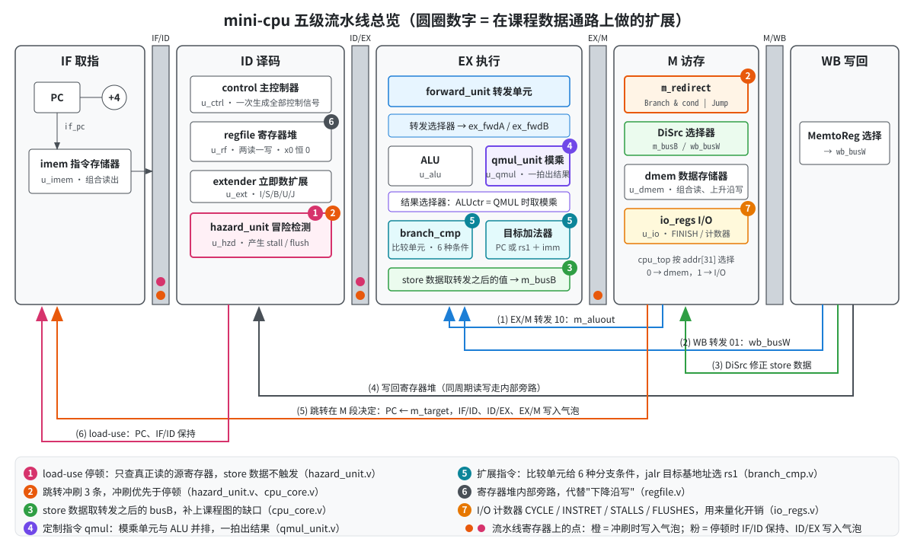
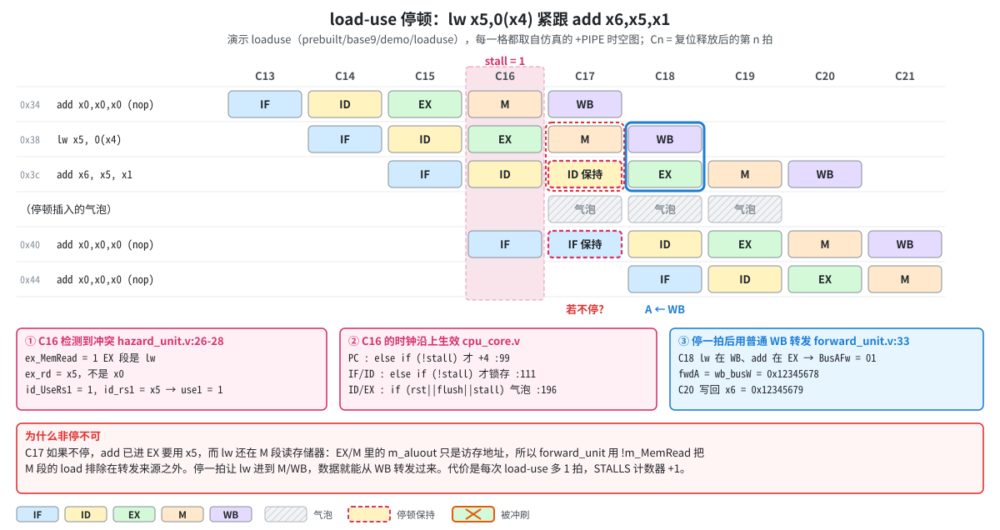
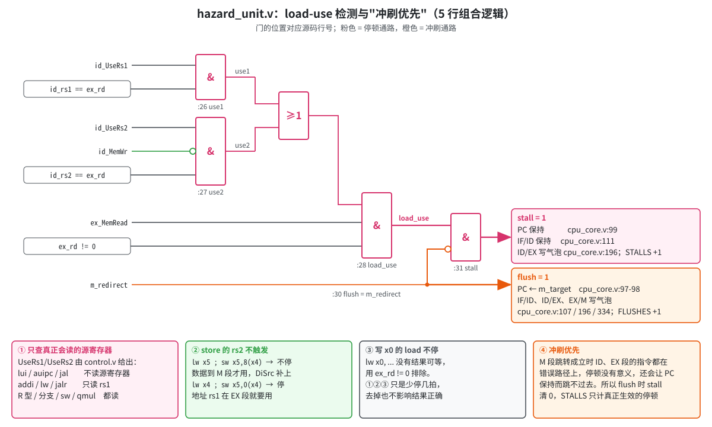
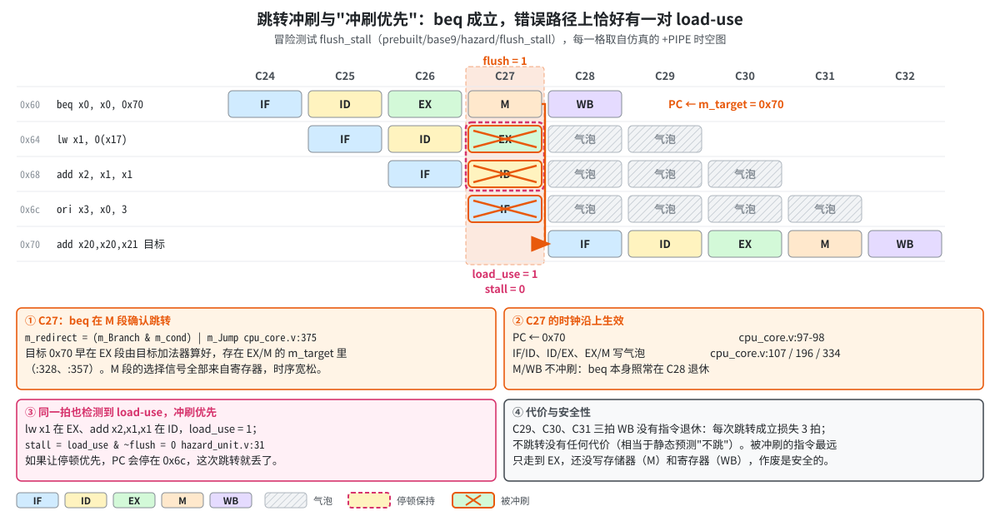
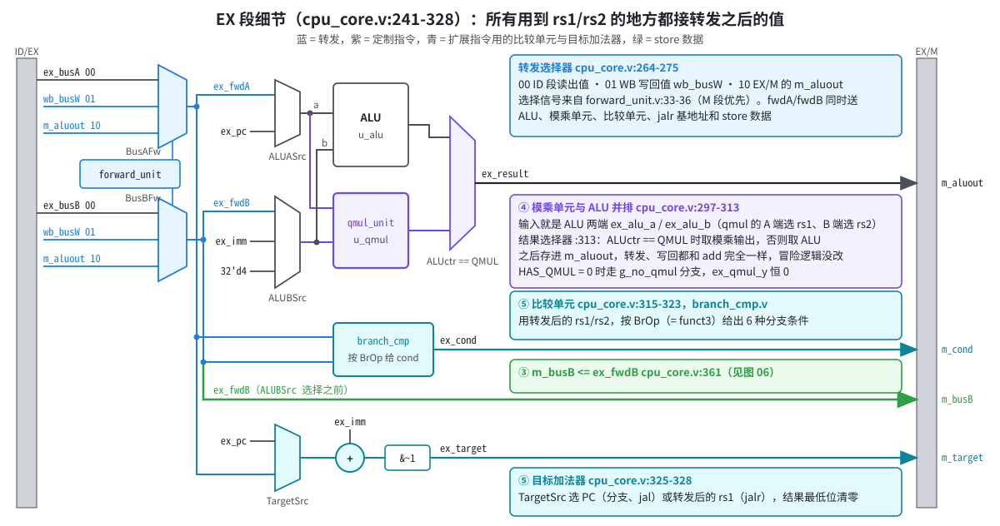
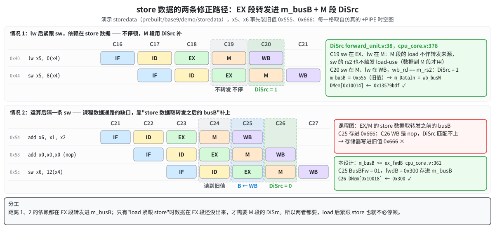
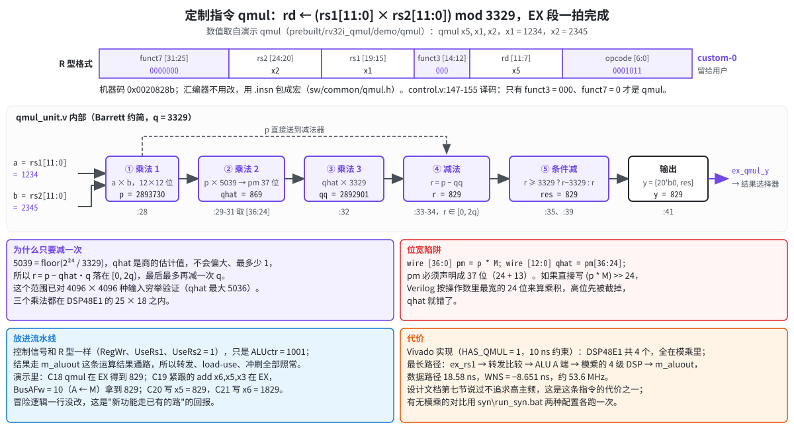

# mini-cpu 代码走读（验收版）

这份走读只讲 `rtl/` 下的设计代码，重点放在我们在课程数据通路之上做的扩展：load-use 停顿、跳转冲刷与冲刷优先、store 数据修正、定制指令 qmul，以及扩展指令集。每一节都按"设计文档里怎么说 → 代码在哪几行 → 仿真里长什么样 → 老师可能怎么问"的顺序展开。

文中的代码片段都是从源文件原样摘出来的，标题里的 `文件:行号` 可以直接在编辑器里跳过去。时空图里的每一格都取自对应演示或测试在仿真里打印的 `+PIPE` 时空图，周期号 Cn 与 ModelSim 波形里的 `cycle`、上机指南里的拍号一致。

图片是 `img/` 下的 SVG，在 VS Code 的 Markdown 预览或 Typora 里会直接显示；也可以单独用浏览器打开。

| 节 | 内容 | 设计文档 | 主要文件 | 配图 |
|---|---|---|---|---|
| 1 | 骨架：模块划分、命名、气泡 | 三、四 | `cpu_top.v` `cpu_core.v` | 01 |
| 2 | 扩展点一：load-use 停顿 | 五 | `hazard_unit.v` `cpu_core.v` | 02、03 |
| 3 | 扩展点二：跳转冲刷与冲刷优先 | 五 | `hazard_unit.v` `cpu_core.v` | 04 |
| 4 | 扩展点三：转发与 store 数据修正 | 五 | `forward_unit.v` `regfile.v` `cpu_core.v` | 05、06 |
| 5 | 扩展点四：定制指令 qmul | 七 | `qmul_unit.v` `control.v` `cpu_core.v` | 07、08 |
| 6 | 扩展点五：扩展指令集 | 六 | `control.v` `alu.v` `branch_cmp.v` | 05 |
| 7 | I/O 计数器与验证方式 | 八、九 | `io_regs.v` `tb/tb_top.v` | — |
| 8 | 验收现场速查 | 九 | — | — |

---

## 1. 骨架：先建立整体印象



### 1.1 文件和层次

`cpu_top` 是综合顶层，里面只有四个实例：流水线核心 `u_core`、指令存储器 `u_imem`、数据存储器 `u_dmem`、I/O 寄存器 `u_io`。`cpu_top.v:52` 用地址第 31 位做地址译码，0 访问数据存储器，1 访问 I/O，读回来的数据在 `cpu_top.v:79` 二选一。

`cpu_core.v` 是整个设计的主体（424 行），按流水线顺序排布，读代码时可以把它当成"一张横向展开的数据通路图"：

| 行号 | 内容 |
|---|---|
| 33-83 | 四个流水线寄存器集中声明（后面的段会反过来用到前面的字段，所以放在最前） |
| 85-101 | IF：PC 更新，优先级"重定向 > 停顿 > PC+4" |
| 103-116 | IF/ID 寄存器 |
| 118-189 | ID：主控制器 `u_ctrl`、寄存器堆 `u_rf`、扩展器 `u_ext`、冒险检测 `u_hzd` |
| 191-239 | ID/EX 寄存器 |
| 241-328 | EX：转发单元、转发选择器、ALU 两端选择、ALU、模乘单元、结果选择器、比较单元、目标加法器 |
| 330-369 | EX/M 寄存器 |
| 371-385 | M：跳转决定 `m_redirect`、DiSrc 选择、数据总线 |
| 387-410 | M/WB 寄存器 |
| 412-415 | WB：MemtoReg 选择得到 `wb_busW` |
| 417-422 | 给 I/O 计数器的事件 |

### 1.2 命名约定：看前缀就知道信号在哪一段

流水线寄存器的输出以"使用它的段"为前缀：IF/ID 的输出是 `id_*`，ID/EX 是 `ex_*`，EX/M 是 `m_*`，M/WB 是 `wb_*`。所以 `ex_pc` 就是"此刻在 EX 段那条指令的 PC"，`m_rd` 就是"M 段那条指令的目标寄存器"。段内的组合信号也用同一前缀，例如 `ex_fwdA`、`m_redirect`。控制信号沿用课程的名字再加段前缀：`ex_ALUctr`、`m_MemWr`、`wb_RegWr`。

记住这一条，后面看转发和冒险检测时就很直观：`forward_unit` 比较的是 `ex_rs1` 和 `m_rd`、`wb_rd`，也就是"EX 段要读的寄存器"和"M、WB 段要写的寄存器"。

### 1.3 三个贯穿全设计的约定

第一，控制信号在 ID 段一次生成，随指令往后传（设计文档第四节）。`control.v` 是纯组合逻辑，只看 opcode、funct3、funct7。

第二，气泡 = 有效位和全部控制信号为 0。气泡照常在流水线里往前走，但 RegWr、MemWr、MemRead、Branch、Jump 都是 0，什么都不改变。停顿、冲刷、复位、非法指令全部用这一个机制，所以 `cpu_core.v` 里你会反复看到 `if (rst || flush ...)` 后面把一组寄存器清 0。气泡在冒险检测里是"隐形"的：RegWr 为 0 不会成为转发来源，MemRead 为 0 不会触发 load-use，不需要任何额外判断。

第三，除了 load，所有写寄存器的指令，结果都从运算结果通路出来，存进 `m_aluout`。jal/jalr 的返回地址 PC+4 由 ALU 算（A 端选 PC，B 端选常数 4），lui 用 ALU 的"直通 B"，qmul 由结果选择器选进同一条通路。这样转发只有两个来源（EX/M 的 `m_aluout`、WB 的 `wb_busW`），写回只有两选一。后面所有扩展都没改冒险逻辑，靠的就是这一条。

---

## 2. 扩展点一：load-use 停顿

设计文档第五节"load-use：转发也解决不了的情况"。课程点名要求的冒险处理之一；我们在课程的基础上加了三处细化。

### 2.1 为什么必须停



lw 的数据要在 M 段从存储器读出。紧跟的 add 到 EX 段需要 x5 时，lw 才在 M 段，EX/M 里的 `m_aluout` 只是访存地址，还不是数据。所以只能让 add 在 ID 多待一拍，等 lw 走到 WB，再用普通的 WB 转发把数据送过来。

对照上图（演示 loaduse）：

- C16：EX 段是 lw（`ex_MemRead = 1`，`ex_rd = x5`），ID 段是 add（读 x5），检测到冲突，`stall = 1`。
- C17：PC（0x40）和 IF/ID（0x3c）保持不变，EX 段是一个气泡。
- C18：add 进入 EX，lw 已在 WB，`BusAFw = 01`，`fwdA = wb_busW = 0x12345678`。
- C20：add 写回 x6 = 0x12345679。

### 2.2 检测逻辑：hazard_unit.v



```verilog
// hazard_unit.v:25-31
    // 只检查真正会被读、且在 EX 段就要用的源寄存器；写 x0 的 load 没有结果可等
    wire use1 = id_UseRs1 && (id_rs1 == ex_rd);
    wire use2 = id_UseRs2 && !id_MemWr && (id_rs2 == ex_rd);
    wire load_use = ex_MemRead && (ex_rd != 5'd0) && (use1 || use2);

    assign flush = m_redirect;
    assign stall = load_use && !flush;
```

课程的基本条件是"EX 段是 load，且它的 rd 等于 ID 段的 rs1 或 rs2"。我们在上面加了三处细化，三处都只是为了少停几拍，去掉任何一处结果仍然正确，只是会多停：

| 细化 | 代码 | 不加会怎样 |
|---|---|---|
| 只查真正会读的源寄存器 | `id_UseRs1` / `id_UseRs2`，由 `control.v` 给出 | lui、auipc、jal 不读源寄存器，addi、lw、jalr 只读 rs1，但这些字段位置上照样有数，碰巧等于 load 的 rd 时会白停一拍 |
| store 的 rs2 不触发 | `use2` 里的 `!id_MemWr` | `lw x5 ; sw x5,8(x4)` 会停一拍。其实 store 数据到 M 段才用，那时 lw 已在 WB，由 DiSrc 补上即可（第 4 节）。注意 store 的地址 rs1 在 EX 段就要用，`lw x4 ; sw x5,0(x4)` 照样要停 |
| 写 x0 的 load 不停 | `ex_rd != 5'd0` | `lw x0, ...` 没有结果可等 |

分支和 jalr 依赖 load 时同样停一拍：它们在 EX 段用转发之后的值做比较、算目标（测试 `base9/hazard/branch_load_dep`、`rv32i/hazard/jalr_load_dep`）。

### 2.3 停顿怎么执行：cpu_core.v 的三处

```verilog
// cpu_core.v:93-101
    // 优先级：重定向 > 停顿 > PC+4
    always @(posedge clk) begin
        if (rst)
            if_pc <= 32'b0;
        else if (m_redirect)
            if_pc <= m_target;
        else if (!stall)
            if_pc <= if_pc_plus4;
    end
```

```verilog
// cpu_core.v:106-116
    always @(posedge clk) begin
        if (rst || flush) begin
            id_valid <= 1'b0;
            id_pc    <= 32'b0;
            id_inst  <= 32'b0;  // 全 0 不是合法指令，译码为气泡
        end else if (!stall) begin
            id_valid <= 1'b1;
            id_pc    <= if_pc;
            id_inst  <= if_inst;
        end
    end
```

```verilog
// cpu_core.v:194-197
    // 停顿、冲刷、复位时写入气泡，否则锁存 ID 段的数据和控制信号
    always @(posedge clk) begin
        if (rst || flush || stall) begin
            ex_valid     <= 1'b0;
```

PC 和 IF/ID 在 `stall = 1` 时不更新（`else if (!stall)` 不成立，寄存器保持），ID/EX 写入气泡。EX/M、M/WB 不受停顿影响，lw 照常往前走。和设计文档第五节"三件事"一一对应。

### 2.4 可能被问到的

**为什么是 ID/EX 进气泡，而不是 IF/ID？** add 必须留在 ID，下一拍重新读寄存器、重新做检测；它前面的 EX 段要空出来。所以冻结 PC 和 IF/ID，往 ID/EX 塞气泡。

**数据存储器是组合读出的，M 段当拍就有数据，为什么不直接把 M 段的读出值转发给 EX？** 功能上可以，但那样"访存地址 → 存储器读出 → 转发选择 → ALU"会串在同一拍里，最长组合路径明显变长。设计采用的是课程的经典做法：停一拍，再从 WB 转发。所以 `forward_unit.v:29` 用 `!m_MemRead` 把 M 段的 load 明确排除在转发来源之外。

**C17 add 留在 ID 时读到的 x5 是旧值，会不会出错？** 不会。C17 时 lw 还在 M，寄存器堆里确实是旧值，但 C18 add 进 EX 时转发单元选 01，用 `wb_busW` 覆盖了这个旧值。

**STALLS 计数器统计的是什么？** `stall` 为 1 的拍数，也就是真正生效的停顿。和冲刷同一拍的 load-use 不算（见第 3 节）。loaduse 演示结束时 `stalls=2`：一次是 0x38/0x3c，另一次是程序末尾 0x68 的 lw 紧跟 0x6c 的 beq。

**qmul 依赖 load 呢？** 照样停。qmul 的 UseRs1、UseRs2 都是 1，和 R 型一样（测试 `rv32i_qmul/hazard/qmul_load_use`）。

---

## 3. 扩展点二：跳转冲刷与"冲刷优先"

设计文档第五节"控制冒险：跳转与冲刷""停顿和冲刷同时发生"。课程的冒险数据通路没有画这一块，是我们必须补上的。



### 3.1 跳转在 M 段决定

```verilog
// cpu_core.v:374-375
    // 跳转在 M 段决定：选择信号全部来自寄存器，时序宽松
    assign m_redirect = (m_Branch & m_cond) | m_Jump;
```

跳转目标和分支条件都在 EX 段算好（目标加法器 `cpu_core.v:327-328`，比较单元 `cpu_core.v:318-323`），存进 EX/M 的 `m_target`、`m_cond`。M 段只做一个与或，选择信号全部来自寄存器。这和课程数据通路的 `Branch & Zero | Jump` 形状相同，只是 Zero 推广成了"条件成立"。

### 3.2 冲刷哪些寄存器

`flush = m_redirect`（`hazard_unit.v:30`）。冲刷时：

- PC ← `m_target`（`cpu_core.v:97-98`）；
- IF/ID 写气泡（`cpu_core.v:107` 的 `rst || flush`）；
- ID/EX 写气泡（`cpu_core.v:196` 的 `rst || flush || stall`）；
- EX/M 写气泡（`cpu_core.v:334` 的 `rst || flush`）；
- M/WB 不冲刷（`cpu_core.v:391` 只有 `rst`）：跳转指令自己要继续走到 WB，jal/jalr 还要写回返回地址。

```verilog
// cpu_core.v:333-335
    always @(posedge clk) begin
        if (rst || flush) begin
            m_valid    <= 1'b0;
```

对照上图（测试 flush_stall）：C27 beq 在 M 段成立，下一拍 C28 IF 是目标 0x70，ID/EX/M 三级都是气泡；C29、C30、C31 三拍 WB 没有指令退休。每次跳转成立损失 3 拍，不跳转没有代价，相当于静态预测"不跳"。

### 3.3 冲刷优先：两层保证

图中 C27 同时发生了两件事：beq 在 M 段成立，而错误路径上的 lw x1（EX）和 add x2,x1,x1（ID）恰好构成 load-use，`load_use = 1`。这时必须冲刷优先：这两条都在错误路径上，停它们没有意义；更关键的是停顿会让 PC 保持在 0x6c，跳转就丢了。

代码里有两层保证：

1. `cpu_core.v` 各寄存器的判断顺序本身就是冲刷在前：PC 先看 `m_redirect`（:97），IF/ID 先看 `rst || flush`（:107），ID/EX 停顿和冲刷都写气泡（:196）。所以即使 stall 和 flush 同时为 1，流水线行为也是对的。
2. `hazard_unit.v:31` 的 `stall = load_use && !flush` 再把 stall 清掉，让 `stall` 这个信号的含义变成"真正生效的停顿"，STALLS 计数器（`io_regs.v:36`）也就不会多计。

验收时如果被问"冲刷优先体现在哪"，这两层都可以说；第二层是语义和计数上的，第一层才是行为上的。

### 3.4 可能被问到的

**为什么不把跳转提前到 EX 段，少损失一拍？** 设计文档给了三条理由：和课程数据通路一致；提前到 EX 的话"转发选择 → 比较 → 选下一个 PC"要挤进一拍，正好叠在 CPU 最长的组合路径上，放在 M 段 PC 的选择信号直接来自寄存器；分支、jal、jalr 都从同一处、同一种方式重定向，冲刷逻辑只有一份。多损失的那一拍可以用 FLUSHES 计数器量化，是设计文档第十一节列出的改进方向。

**被冲刷的指令会不会已经写了存储器或寄存器？** 不会。跳转在 M 段确定时，被作废的三条分别在 IF、ID、EX，最远只到 EX；写存储器在 M，写寄存器在 WB。由此还有一个性质：能进入 M 段的指令一定在正确路径上，所以 store、I/O 写都不会写错地方（测试 `base9/hazard/jump_store`）。

**jal 也要冲刷 3 条吗？** 是。jal 和分支走同一条路，`m_Jump = 1` 就重定向。jal 的目标在译码时就已知，理论上可以在 ID 段就跳，损失降到 1 拍，这是可选的改进，当前没做。

**连续跳转（跳转目标处又是跳转）怎么办？** 每次各自冲刷，互不干扰（测试 `base9/hazard/jump_chain`）。

**jalr 的目标基地址依赖前一条 add 呢？** 目标基地址取的是转发之后的 rs1（`ex_fwdA`），所以照常转发（测试 `rv32i/hazard/jalr_alu_dep`）；依赖 load 时停一拍（`jalr_load_dep`）。

---

## 4. 扩展点三：转发与 store 数据修正

设计文档第五节"转发单元""寄存器堆的同周期读写""store 数据：课程数据通路的一个缺口"。转发是课程点名的；store 数据取转发后的值是我们对课程数据通路唯一一处"修正"；寄存器堆旁路是我们对"下降沿写"的替代。

### 4.1 三种距离，三样东西

| 距离 | 例子 | 由谁解决 | 代码 |
|---|---|---|---|
| 1 | `add x1,..` ; `sub x2,x1,..` | EX/M 转发（10） | `forward_unit.v:33-36` |
| 2 | `add x1,..` ; 无关 ; `or x2,x1,..` | WB 转发（01） | 同上 |
| 3 | `add x1,..` ; 无关 ; 无关 ; 读 x1 | 寄存器堆同周期旁路 | `regfile.v:31-35` |

少了任何一样，总有一种距离的依赖会算错。距离 4 及以上时写者早已写完，正常读寄存器堆即可。

### 4.2 forward_unit.v

```verilog
// forward_unit.v:27-38
    // 能作为转发来源的条件：真的写寄存器（store、分支的 rd 字段是立即数），且不是 x0。
    // M 段的 load 在 EX/M 里只有访存地址，不是它要写回的数据，所以排除。
    wire m_src  = m_RegWr && !m_MemRead && (m_rd != 5'd0);
    wire wb_src = wb_RegWr && (wb_rd != 5'd0);

    // M 段优先：M 段那条离 EX 更近，值更新
    assign BusAFw = (m_src  && m_rd  == ex_rs1) ? `FW_M  :
                    (wb_src && wb_rd == ex_rs1) ? `FW_WB : `FW_ID;
    assign BusBFw = (m_src  && m_rd  == ex_rs2) ? `FW_M  :
                    (wb_src && wb_rd == ex_rs2) ? `FW_WB : `FW_ID;

    assign DiSrc  = m_MemWr && wb_src && (wb_rd == m_rs2);
```

设计文档列的五条关键细节，在这里各对应一处：只看 RegWr = 1 的指令（store、分支的 rd 字段是立即数）；排除 x0（测试 `x0_write`）；M 段优先，用三目运算的先后顺序实现（测试 `waw_mprio`）；M 段的 load 不参与转发（`!m_MemRead`）；WB 转发送的是 `wb_busW`，也就是 MemtoReg 选择之后的最终写回值，load 的数据和运算结果同等对待。

### 4.3 EX 段：转发之后的值送到哪里



转发选择器（`cpu_core.v:264-275`）的输出 `ex_fwdA`、`ex_fwdB` 被送到所有用到 rs1/rs2 的地方：ALU 两端（经 ALUASrc/ALUBSrc 选择）、模乘单元、比较单元、jalr 的目标基地址，以及 store 数据。这一点很重要，"分支依赖刚算出的值""jalr 依赖刚算出的值"之所以不用额外处理，就是因为比较单元和目标加法器接的都是转发之后的值。

### 4.4 store 数据：课程图的缺口



按课程图的连线，进入 EX/M 的 store 数据是转发选择器之前的 busB。只靠 M 段的 DiSrc 补救，会漏掉"运算后隔一条 store"：上图情况 2 里，sw 在 ID 段（C24）读到旧值 0x666；在 EX 段（C25）转发单元已经发现依赖，`BusBFw = 01`，但课程图里转发后的值只进了 ALU；到 M 段（C26）add 已经离开流水线，WB 里是那条 nop，DiSrc 匹配不上。最终写进存储器的是旧值。

我们的改法只有一行：

```verilog
// cpu_core.v:359-361
            // store 数据取转发选择器之后、ALUBSrc 选择器之前的 busB。
            // "运算后隔一条 store"的依赖只能在这里转发：store 到 M 段时写者已离开流水线
            m_busB     <= ex_fwdB;
```

注意是 ALUBSrc 选择器之前：sw 的 ALU B 端选的是立即数（算地址），store 数据必须从选择器前面分出来。

DiSrc 继续保留，专门处理"load 后紧跟 store"（上图情况 1）：那时 load 的数据在 EX 段还没出来，只能在 M 段补。

```verilog
// cpu_core.v:377-378
    // DiSrc：load 后紧跟 store 时，用 WB 段的写回值修正 store 数据
    wire [31:0] m_DataIn = m_DiSrc ? wb_busW : m_busB;
```

两者分工：距离 1、2 的依赖都在 EX 段转发进 `m_busB`；只有 load 紧跟 store 需要 DiSrc。也正因为有 DiSrc，第 2 节里 store 的 rs2 才可以不触发 load-use。

### 4.5 寄存器堆同周期旁路

```verilog
// regfile.v:31-35
    wire byp1 = we && (wa != 5'd0) && (wa == ra1);
    wire byp2 = we && (wa != 5'd0) && (wa == ra2);

    assign rd1 = (ra1 == 5'd0) ? 32'b0 : byp1 ? wd : regs[ra1];
    assign rd2 = (ra2 == 5'd0) ? 32'b0 : byp2 ? wd : regs[ra2];
```

距离 3 时，WB 段在这一拍的时钟沿才写入，同一拍 ID 段正在读。教科书的办法是下降沿写寄存器堆；我们改成内部旁路：正在写的寄存器正好是正在读的（且不是 x0），读端口直接输出即将写入的值。这样全部逻辑只用上升沿，时序分析简单（在 FPGA 上混用双沿相当于把部分路径的时间预算砍掉一半）。pipeline 演示里 C32 beq 在 ID、lw 在 WB，就是经这条旁路读到新值的。

### 4.6 可能被问到的

**运算后紧跟 store 时，EX/M 转发已经把新值存进 `m_busB`，到 M 段 DiSrc 也会匹配上，会不会出错？** 不会。DiSrc 选的 `wb_busW` 正是那条运算指令的结果，和 `m_busB` 里已经是同一个值，选哪个都一样。这符合 DiSrc 的定义，只是波形里能看到 DiSrc = 1。

**转发只按寄存器号判断，不看 EX 段那条指令是否真的读这个操作数，会不会出错？** 不会。例如 ori 的 rs2 字段其实是立即数的一部分，碰巧匹配时 BusBFw 也会非 0，但 ori 的 B 端选的是立即数，转发来的值用不到。时空图和波形里能看到这种"无害的转发"，不要误以为是 bug。

**为什么 WB 转发送 `wb_busW` 而不是 `wb_aluout`？** 因为 WB 段可能是 load，它要写回的是存储器数据。送 MemtoReg 选择之后的值，load 和运算指令就同等对待了。

---

## 5. 扩展点四：定制指令 qmul

设计文档第七节。这是验收的重点之一，建议把这一节读熟。



### 5.1 指令定义和译码

qmul rd, rs1, rs2：rd ← (rs1[11:0] × rs2[11:0]) mod 3329，操作数按无符号数，结果在 [0, 3328]，高 20 位为 0。R 型格式，opcode 用 RISC-V 留给用户的 custom-0（0001011），funct3 = 000、funct7 = 0000000。汇编器不用改，`sw/common/qmul.h` 用 `.insn r 0x0b, 0, 0, rd, rs1, rs2` 包成宏。

```verilog
// control.v:147-155
            `OP_CUSTOM0: begin
                if (HAS_QMUL != 0 && funct3 == 3'b000 && funct7 == 7'b0000000) begin
                    // qmul：和 R 型运算一样读 rs1、rs2，结果由 EX 段的结果选择器取模乘单元的输出
                    ALUctr = `ALU_QMUL;
                    RegWr  = 1'b1;
                    UseRs1 = 1'b1;
                    UseRs2 = 1'b1;
                end
            end
```

控制信号和 R 型运算完全一样，唯一的区别是 ALUctr = 1001（`defines.vh:50`）。1001 是 `{inst[30], funct3}` 编码里合法 RV32I 指令用不到的组合，所以不会和别的运算冲突。custom-0 里 funct3、funct7 是其他值的编码一律按非法指令处理（输出气泡），留给以后的 qadd、qsub。

### 5.2 放进流水线：与 ALU 并排

```verilog
// cpu_core.v:297-313
    // 模乘单元：和 ALU 并排，输入同样是 ALU 两端（qmul 的 ALUASrc 选 rs1、ALUBSrc 选 rs2）
    wire [31:0] ex_qmul_y;

    generate
        if (HAS_QMUL != 0) begin : g_qmul
            qmul_unit u_qmul (
                .rs1 (ex_alu_a),
                .rs2 (ex_alu_b),
                .y   (ex_qmul_y)
            );
        end else begin : g_no_qmul
            assign ex_qmul_y = 32'b0;   // 译码器不会给出 ALU_QMUL，下面的选择器被综合掉
        end
    endgenerate

    // 结果选择器：运算结果通路上的值，存进 EX/M（m_aluout），之后的转发、写回都用它
    wire [31:0] ex_result = (ex_ALUctr == `ALU_QMUL) ? ex_qmul_y : ex_aluout;
```

模乘单元的输入是 ALU 两端 `ex_alu_a`、`ex_alu_b`，qmul 的 ALUASrc 选 rs1、ALUBSrc 选 rs2，所以拿到的就是转发之后的 rs1、rs2。输出经结果选择器进 `m_aluout`，之后和 add 的结果走同一条路：EX/M 转发、WB 转发、写回。转发、load-use、冲刷全部照常适用，冒险逻辑一行没改。

演示 qmul 里可以看到这一点：C18 qmul 在 EX 段，一拍算出 829；C19 紧跟的 `add x6, x5, x3` 在 EX 段，`BusAFw = 10`（A ← M）拿到 829；C20 写 x5 = 0x33d，C21 写 x6 = 1829。冒险测试 `rv32i_qmul/hazard/` 下还有距离 1、2、load-use、冲刷、store 五种场景。

参数 `HAS_QMUL` 从 `cpu_top` 一路传到 `cpu_core` 和 `control`。为 0 时 generate 走 `g_no_qmul` 分支，模乘单元不例化，译码器把 qmul 当非法指令。这个开关用来综合"无模乘"的对照组，评估这条指令的硬件代价。

### 5.3 qmul_unit.v：Barrett 约简

```verilog
// qmul_unit.v:20-41
    localparam [11:0] Q = 12'd3329;
    localparam [12:0] M = 13'd5039;

    wire [11:0] a = rs1[11:0];
    wire [11:0] b = rs2[11:0];

    // 各中间量按完整位宽计算，再取用得到的位；高位里恒为 0 或用不到的部分不报 lint
    /* verilator lint_off UNUSEDSIGNAL */
    wire [23:0] p    = a * b;                 // 乘法 1：12 × 12
    wire [36:0] pm   = p * M;                 // 乘法 2：24 × 13。必须用 37 位接住整个乘积：
                                              // 直接写 (p * M) >> 24 会按 24 位计算，高位被截掉
    wire [12:0] qhat = pm[36:24];
    wire [23:0] qq   = qhat * Q;              // 乘法 3：13 × 12，qq ≤ p
    wire [23:0] diff = p - qq;                // 在 [0, 2q) 内，高 11 位恒为 0
    wire [12:0] r    = diff[12:0];
    wire [12:0] r_q  = r - {1'b0, Q};         // r ≥ q 时在 [0, q) 内，第 12 位为 0
    /* verilator lint_on UNUSEDSIGNAL */

    // 最后一次条件减
    wire [11:0] res = (r >= {1'b0, Q}) ? r_q[11:0] : r[11:0];

    assign y = {20'b0, res};
```

思路是把"除以 3329"换成"乘以 2²⁴/3329 再右移 24 位"。5039 = floor(2²⁴ / 3329)，用它估出的商 qhat 不会偏大、最多少 1，所以 r = p − qhat × 3329 一定落在 [0, 2q)，最后最多再减一次 q。这个范围已经对全部 4096 × 4096 种输入穷举验证过（`scripts/check_barrett.py`；我也重新跑了一遍，qhat 最大 5036，没有一组 r 超出 [0, 2q)）。

用演示的数代进去：a = 1234，b = 2345，p = 2893730，qhat = 869，qq = 869 × 3329 = 2892901，r = 829 < 3329，所以 y = 829，和 (1234 × 2345) mod 3329 一致。

### 5.4 收益和代价


评估程序是 Kyber 正向 NTT（896 次蝴蝶），两个版本只差模乘这一处：`ntt_sw` 的 `MODMUL` 宏调用软件模乘子程序（jal 调用、jalr 返回，移位加法求积、移位减法取模），`ntt_qmul` 的 `MODMUL` 就是一条 qmul。按 MARK 2 − MARK 1 统计：

| | 周期 | 退休指令 | 冲刷 | CPI |
|---|---|---|---|---|
| ntt_sw | 215602 | 151966 | 21212 | 1.42 |
| ntt_qmul | 19600 | 16915 | 895 | 1.16 |
| 比值 | 11.0 倍 | 9.0 倍 | 23.7 倍 | |

周期数的 11 倍可以拆成两部分：指令数少了约 9 倍；软件模乘的循环每轮都有一次回跳，每跳一次冲刷 3 拍，qmul 把这些分支也一起消掉了，所以 CPI 也从 1.42 降到 1.16。两个程序在两次 MARK 之间 STALLS 都是 0。两个版本的输出都和 Python 参考实现逐项相等，测试平台最后打印 `RESULT: PASS`。

代价方面，`vivado/mini_cpu` 工程里现有的实现报告（HAS_QMUL = 1，10 ns 约束）显示：DSP48E1 共 4 个，全部在模乘单元里（三个乘法，减法也并进了 DSP）；最长路径从 `ex_rs1` 出发，经转发比较、ALU A 端选择、模乘的 4 级 DSP，到 `m_aluout`，数据路径 18.58 ns，WNS = −8.651 ns，折合约 53.6 MHz。设计文档第七节已经说明不追求高主频、先保证单周期完成，这个时序就是这条指令代价的一部分。和无模乘配置的对比需要用 `syn\run_syn.bat` 两种配置各跑一次，看 `syn\out\qmul\summary.txt` 与 `syn\out\noqmul\summary.txt`，验收前建议跑一遍把数记下来。

### 5.5 可能被问到的

**为什么选 Kyber、为什么是模乘？** 基础 RV32I 没有乘法，软件模乘要上百拍，还带大量循环分支，在我们的 CPU 上每跳一次再赔 3 拍；而 q = 3329 是 12 位小常数，硬件做单周期很小。NTT 蝴蝶的模加、模减软件里 5 条无分支指令就能做完，开销几乎全在模乘，所以一条 qmul 就拿到了绝大部分收益；只做一条还让测出的加速可以完全归到这条指令上。

**为什么不直接写 `(a * b) % 3329`？** 对非 2 的幂常数取模，综合工具通常会生成一个组合除法器，面积和延迟都大得多。Barrett 把取模变成乘常数加减法，三个乘法都在 DSP48E1 的 25 × 18 之内。

**为什么 `pm` 要声明成 37 位？** Verilog 表达式的位宽由上下文决定。如果写 `wire [12:0] qhat = (p * M) >> 24;`，乘积按操作数和目标里最宽的 24 位计算，高位在右移之前就被截掉了，qhat 会错。先用 37 位（24 + 13）的线接住完整乘积，再取 [36:24]。

**rs1、rs2 的高 20 位怎么处理？** 直接忽略，只取低 12 位。规格里特意定义了任意输入下的结果，这样参考模型能和硬件逐位一致，随机测试可以喂任意值。单元测试 `tb/unit/tb_qmul.v` 对低 12 位穷举 4096 × 4096 种，并抽查 100 万组高位随机的输入。

**加了 qmul，冒险处理改了什么？** 什么都没改。它读 rs1、rs2，写 rd，EX 段一拍出结果，走 `m_aluout` 通路，对流水线来说和 add 没有区别。

**如果模乘做成两拍或流水化以提高主频，要改什么？** 那就不再是"EX 一拍出结果"了：紧跟的依赖指令要像 load-use 一样停顿，或者增加新的转发来源，冒险逻辑要跟着改。这是当前设计刻意避开的复杂度。

---

## 6. 扩展点五：扩展指令集

设计文档第六节。课程点名的是移位、bne/blt/bge、auipc；我们按"组"扩展，做了全部整数运算、六种分支、jalr 和 auipc。访存仍然只有 lw、sw。

### 6.1 ALUctr = {inst[30], funct3}

`defines.vh:41-52` 把 ALUctr 编码直接定成 `{inst[30], funct3}`。R 型运算直接取它，add/sub、srl/sra 靠第 30 位区分；立即数运算的第 30 位是立即数的一位（addi 没有减法版本），所以取 `{0, funct3}`，只有 srli/srai 例外：

```verilog
// control.v:70-80
            `OP_IMM: begin
                if (imm_ok) begin
                    // addi slti sltiu xori ori andi：{0, funct3}；
                    // slli srli srai：和 R 型一样取 {inst[30], funct3}，移位量是立即数的低 5 位
                    ExtOp   = `EXT_I;
                    ALUBSrc = `BSRC_IMM;
                    ALUctr  = (funct3 == 3'b101) ? {funct7[5], funct3} : {1'b0, funct3};
                    RegWr   = 1'b1;
                    UseRs1  = 1'b1;
                end
            end
```

如果 addi 也取 `{inst[30], funct3}`，立即数第 10 位为 1 的 addi（例如 `addi x1, x0, -1`）就会被当成减法。这是一个很好的"为什么"问题。

没有被合法指令用到的编码留给了别的运算：1111 是直通 B（lui），1001 是 QMUL。

### 6.2 几条"不加新硬件"的指令

lui：ExtOp = U，ALUBSrc 选立即数，ALU 直通 B（`alu.v:27`），不必在 A 端加常数 0。auipc：ALUASrc 选 PC，ALUBSrc 选 U 型立即数，ALU 做加法，用的正是课程数据通路在 A 端准备的 PC 这一路。jal/jalr 的返回地址：A 端 PC，B 端常数 4，ALU 做加法。

### 6.3 比较单元和目标加法器

分支条件不再用 ALU 的 Zero，而是由和 ALU 并列的比较单元 `branch_cmp.v` 给出。译码器把条件分支的 funct3 原样作为 BrOp 传下去（`control.v:119`），比较单元按 BrOp 选 eq、ne、lt、ge、ltu、geu 六种之一。它用转发之后的 rs1、rs2，分支从此不占用 ALU。

jalr 需要把目标加法器的基地址从 PC 换成 rs1，并且最低位清零：

```verilog
// cpu_core.v:325-328
    // 目标加法器：分支、jal 是 PC + imm；jalr 是转发之后的 rs1 + imm。最低位清零（jalr 的要求，
    // 分支和 jal 的目标本来就是偶数）
    wire [31:0] ex_tgt_base = (ex_TargetSrc == `TSRC_RS1) ? ex_fwdA : ex_pc;
    wire [31:0] ex_target   = (ex_tgt_base + ex_imm) & ~32'd1;
```

### 6.4 非法指令

`control.v` 的默认值就是气泡的控制信号（`control.v:44-58`），只有能识别的编码才会改写。字节/半字访存、fence、ecall、CSR、funct7 不合法的 R 型、第 25 位非 0 的移位立即数、funct3 为 010/011 的分支，以及 HAS_QMUL = 0 时的 qmul，全部按气泡处理，有效位照常为 1（计入 INSTRET）。单元测试 `tb/unit/tb_control.v` 对 opcode × funct3 × funct7 全部 2¹⁷ 种组合逐字段对照，HAS_QMUL = 1、0 各跑一次。

---

## 7. I/O 计数器与验证方式

### 7.1 I/O 计数器

我们不实现 CSR，性能计数器通过 I/O 地址读（基址 0x8000_0000，`defines.vh:68-73`）：CYCLE、INSTRET、STALLS、FLUSHES 只读，FINISH、MARK 只写。`io_regs.v:27-39` 每拍更新；`retire = wb_valid`、`stall_evt = stall`、`flush_evt = flush` 由 `cpu_core.v:420-422` 引出。程序写 FINISH 表示结束（写 0 为通过），写 MARK 让测试平台打印当时的计数器快照，NTT 的周期数就是两次 MARK 之差。

### 7.2 怎么证明是对的

验证以对拍为核心（设计文档第九节）：`model/iss.py` 是独立的 Python 指令级模拟器，生成"退休轨迹"（每次写寄存器的 PC、rd、值，每次写存储器的地址、数据）；测试平台 `tb/tb_top.v:366-370` 从 WB 段采集寄存器写、从 M 段采集存储器写，逐条在线比对，第一处不一致就报出周期和 PC。

测试分四层：单指令、冒险场景（设计文档第五节场景表每一行一个测试）、随机（每层 30 个固定种子）、程序（sum、checksum、sort、fib、crc32、NTT 等）。`prebuilt/tests.lst` 共 175 个，ModelSim 里 `sim\modelsim\regress.bat` 一条命令跑完。写这份走读时，我用开源仿真器 iverilog 在同一个测试平台上把 175 个全部重跑了一遍，全部 PASS；文中的时空图和 NTT 数据也都出自这次仿真，和上机指南里记录的数一致。

---

## 8. 验收现场速查

演示命令：`sim\modelsim\run_demo.bat <名字>`。光标位置和要看的值详见上机指南第 3 节，这里只列和本文各节的对应关系：

| 演示 | 对应本文 | 关键周期 | 一句话 |
|---|---|---|---|
| pipeline | 1 | C26～C36 | 五级同时有指令，每拍退休一条；C32 寄存器堆旁路；C35 jal 冲刷 |
| forward | 4 | C18、C24 | BusAFw = 10、BusBFw = 01，ALU 拿到新值 |
| loaduse | 2 | C16～C20 | C16 stall，C17 EX 气泡，C18 从 WB 转发 |
| storedata | 4 | C20、C25、C26 | C20 DiSrc；C25 fwdB = 0x300 存进 m_busB |
| flush | 3 | C23、C27、C31 | beq、jal、jalr 在 M 段，下一拍前三级 valid 为 0 |
| ext | 6 | C23～C37 | 移位结果；bne、blt 冲刷，bge 不成立；auipc、jalr |
| qmul | 5 | C18～C21 | 一拍出 829，紧跟的 add 通过 A ← M 拿到 |

"冲刷优先"没有单独的演示，可以用 `sim\modelsim\run_one.bat base9/hazard/flush_stall +PIPE` 打开，看 C27（图 04）：flush = 1、stall = 0，波形里把 `/tb_top/u_cpu/u_core/u_hzd/load_use` 拖进来，能看到它同一拍为 1。

验收时被问到某个机制时，比较稳的回答顺序是：先说它解决什么问题（设计文档里的那个场景），再指出代码在哪个文件、哪几行，最后打开对应的演示指给老师看现象。
